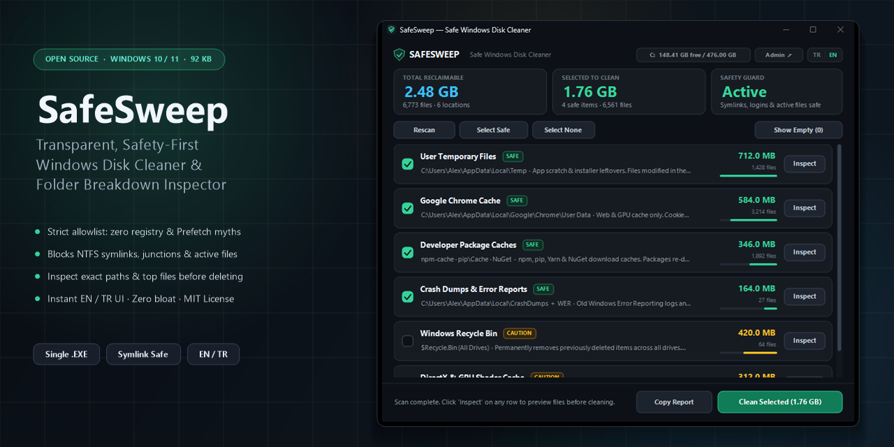
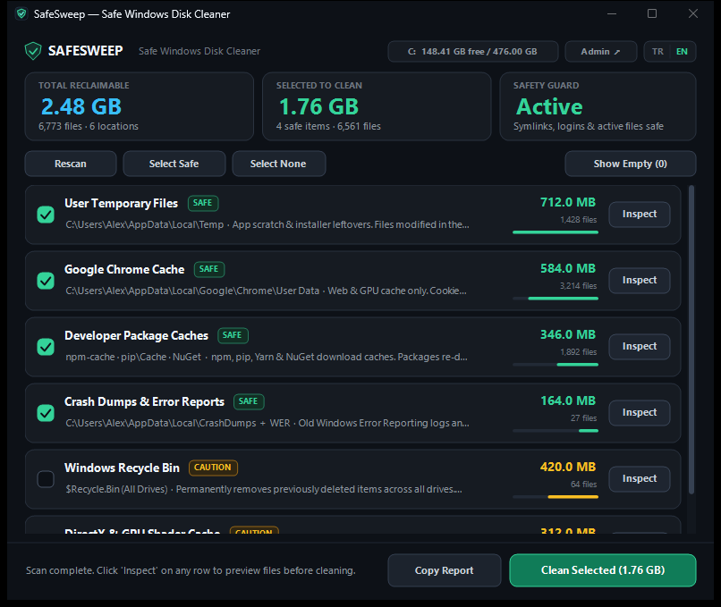
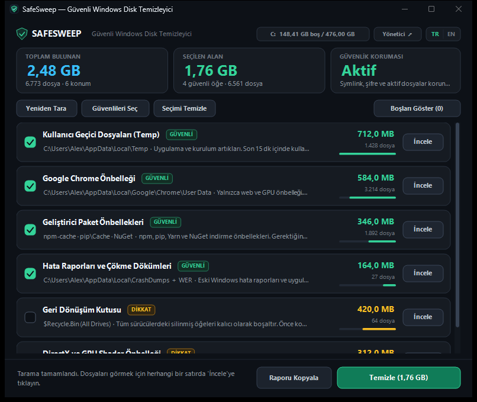
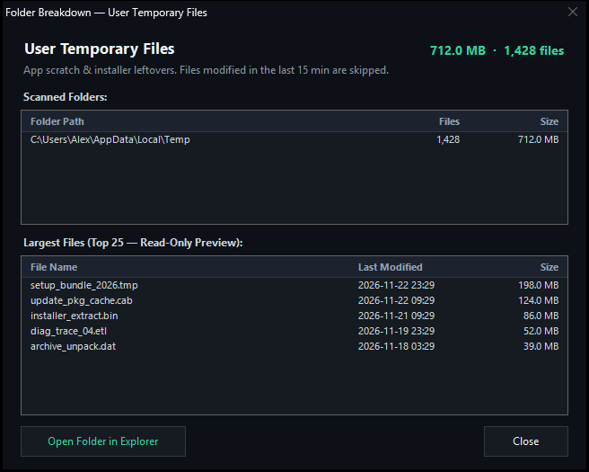
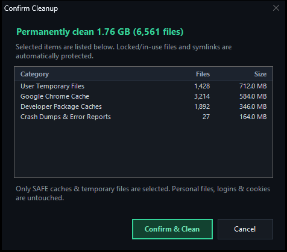

<p align="center">
  
</p>

<h1 align="center">SafeSweep</h1>

<p align="center">
  <strong>A tiny (~92 KB), zero-dependency, safety-first Windows disk cleaner that shows exact folder-by-folder breakdowns and lets you inspect every location before cleaning.</strong>
</p>

<p align="center">
  
  
  
  
</p>

<p align="center">
  <a href="#english"><b>English Documentation</b></a> &nbsp;·&nbsp; <a href="#türkçe"><b>Türkçe Açıklama</b></a> &nbsp;·&nbsp; <a href="https://github.com/rodvay/SafeSweep/releases/latest"><b>Download Latest Release</b></a>
</p>

---

<a id="english"></a>

## Why SafeSweep?

Many traditional "PC cleaner" utilities bundle telemetry, upsells, risky registry cleaners, or blindly delete caches that degrade performance (`Prefetch`, `SoftwareDistribution`, active installers) or wipe browser logins.

**SafeSweep** takes the opposite approach:
- **Read-only scan first** — nothing is ever touched until you explicitly check items, click **Clean Selected**, and confirm in a mandatory summary dialog.
- **Full folder transparency** — every category displays its exact folder path, file count, total size, safety tier (`SAFE` vs `CAUTION`), and an **Inspect** window listing individual subfolders & the 25 largest files (with 1-click *Open in Explorer*).
- **Defense-in-depth filesystem safety** — strict allowlists, NTFS symlink/junction protection, OneDrive cloud-placeholder protection, active-installer freshness guard, and zero registry tampering.

---

## Screenshots

<table>
  <tr>
    <td align="center" width="50%">
      <br />
      <sub><b>English UI</b> — Folder breakdown with SAFE & CAUTION tiers</sub>
    </td>
    <td align="center" width="50%">
      <br />
      <sub><b>Turkish UI</b> — Instant 1-click TR / EN switching</sub>
    </td>
  </tr>
  <tr>
    <td align="center" width="50%">
      <br />
      <sub><b>Folder Inspector</b> — View subfolders, top 25 largest files & open in Explorer</sub>
    </td>
    <td align="center" width="50%">
      <br />
      <sub><b>Mandatory Confirmation</b> — Full review before any byte is deleted</sub>
    </td>
  </tr>
</table>

---

## Safety Architecture (What Is Cleaned & What Is Strictly Off-Limits)

### Built-in Safety Guards (`SafetyGuard` in `CleanupEngine.cs`)
1. **Strict Allowlist + Protected Root Rejection:** Hard-blocks drive roots (`C:\`), `Windows`, `System32`, `Program Files`, `UserProfile`, `Desktop`, `Documents`, `Downloads`, `Pictures`, `Videos`, `Music`, and `OneDrive` — even if an environment variable like `%TEMP%` is misconfigured.
2. **NTFS Symlink, Junction & Cloud Placeholder Guard:** Checks `FILE_ATTRIBUTE_REPARSE_POINT`, `FILE_ATTRIBUTE_OFFLINE`, `FILE_ATTRIBUTE_RECALL_ON_OPEN`, and `FILE_ATTRIBUTE_RECALL_ON_DATA_ACCESS` before entering any directory or deleting any file. **Never follows directory junctions or symlinks** and never triggers OneDrive hydration.
3. **15-Minute Active-File Freshness Guard:** In Temp folders, any file created or modified within the last 15 minutes is automatically preserved so running installers, compilers, or archive extractions are never interrupted.
4. **Root Directory Preservation:** Only deletes disposable items *strictly inside* allowlisted cache folders — never deletes the root Temp or Cache directory itself, preserving Windows NTFS ACLs.
5. **Graceful Lock Handling:** Never force-kills browsers or apps. Detects open browsers (`RUNNING` tag) and safely skips locked/in-use files, reporting the exact deleted vs. skipped counts.

### What SafeSweep Cleans

| Tier | Category | Scope & Safety Note | Default |
| :---: | :--- | :--- | :---: |
| **SAFE** | **User Temporary Files** (`%LOCALAPPDATA%\Temp`) | Scratch & installer leftovers (>15 min old) | Checked |
| **SAFE** | **Windows System Temp** (`C:\Windows\Temp`) | System temp logs & leftovers (>15 min old; optional UAC elevation for locked admin files) | Checked |
| **SAFE** | **Crash Dumps & Error Reports** (`CrashDumps`, `WER`) | Old `.dmp` minidumps & Windows Error Reporting archives | Checked |
| **SAFE** | **Windows Thumbnail Cache** | Strictly `thumbcache_*.db` and `iconcache_*.db` only | Checked |
| **SAFE** | **Browser Caches** *(Chrome, Edge, Brave, Opera, Firefox)* | Strictly `Cache`, `Code Cache`, `GPUCache`, `Dawn*Cache`, `cache2` — **cookies, passwords, logins, history, bookmarks & extensions are NEVER touched** | Checked |
| **SAFE** | **Discord / Steam / Spotify Web Caches** | Media & store web cache only — games, chats & logins untouched | Checked |
| **SAFE** | **Developer Package Caches** | `npm-cache`, `pip\Cache`, `Yarn\Cache`, `NuGet\v3-cache` (shown only if present) | Checked |
| **CAUTION** | **Windows Recycle Bin** | Native Win32 `SHQueryRecycleBin` / `SHEmptyRecycleBin` (all drives) | **Unchecked** |
| **CAUTION** | **DirectX & GPU Shader Cache** | `D3DSCache`, AMD/NVIDIA/Intel shader caches (games briefly recompile on next launch) | **Unchecked** |

### Intentionally Excluded (Never Touched)
- **Windows Registry** — registry cleaners provide negligible space savings and carry high risk of OS breakage.
- **`C:\Windows\Prefetch`** — Windows self-manages Prefetch; deleting it slows down app launches.
- **`C:\Windows\SoftwareDistribution`** — manually deleting update files while Windows Update runs can break updates (use Windows Storage Sense / `cleanmgr` for update rollbacks).
- **`Downloads` / `Documents` / `Desktop` / `WinSxS`** — personal data and OS component store are strictly protected.
- **SSD Free-Space Wiping** — avoided to protect SSD endurance.

---

## Download & Quick Start

1. Download **`SafeSweep.exe`** (~92 KB) from the **[Releases](https://github.com/rodvay/SafeSweep/releases/latest)** page.
2. Double-click to run — starts as a normal user (no forced UAC prompt). Click **Admin ↗** inside the app only if you want deeper access to `C:\Windows\Temp`.
3. Review the folder breakdown, click **Inspect** on any row to preview files, check the locations you want cleaned, and click **Clean Selected**.

> **Windows SmartScreen Note:** Because `SafeSweep.exe` is an unsigned open-source binary, SmartScreen may warn on first run. Click **More info → Run anyway**, or inspect the clean 3-file C# source and compile it yourself in 2 seconds with `build.bat`.

---

## Building from Source

Requires only Windows 10 or 11 (uses the built-in `.NET Framework 4.x` `csc.exe` compiler — no Visual Studio or SDK download needed):

```bat
git clone https://github.com/rodvay/SafeSweep.git
cd SafeSweep
build.bat
```

## Keyboard Shortcuts

- `F5` — Rescan all folders
- `L` — Switch UI language (**EN** ↔ **TR**)
- **Double-click** any row — Open **Folder Breakdown Inspector**

---

<a id="türkçe"></a>

## Türkçe Açıklama

**SafeSweep**, bilgisayarınızda gereksiz yer kaplayan önbellek ve geçici dosyaları **klasör klasör döküm halinde** gösteren, silmeden önce içindeki dosyaları incelemenize olanak tanıyan, güvenlik odaklı ve açık kaynaklı (~92 KB, tek `.exe`) bir Windows temizlik aracıdır.

### Temel Özellikler
- **Şeffaf Klasör Dökümü:** Her klasörün tam yolunu, dosya sayısını ve kapladığı alanı (MB/GB) canlı olarak listeler. İstediğiniz satırda **İncele** butonuna tıklayarak alt klasörleri ve en büyük 25 dosyayı görebilir, **Klasörü Gezginde Aç** ile doğrulayabilirsiniz.
- **İki Kademeli Güvenlik Sistemi:**
  - **GÜVENLİ (Yeşil):** Kullanıcı/Sistem Temp dosyaları, Windows hata raporları ve çökme dökümleri, küçük resim önbelleği, tarayıcı önbellekleri (Chrome, Edge, Brave, Opera, Firefox — **çerezler, kayıtlı şifreler, oturumlar, geçmiş ve eklentiler kesinlikle korunur**), Discord/Steam/Spotify web önbellekleri ve geliştirici önbellekleri (`npm`, `pip`, `NuGet`).
  - **DİKKAT (Sarı — Varsayılan olarak seçili DEĞİL):** Geri Dönüşüm Kutusu ve DirectX/GPU Shader önbellekleri. Kullanıcı özellikle işaretlemeden asla temizlenmez.
- **Üst Düzey Güvenlik Korumaları:**
  - **NTFS Symlink / Junction Koruması:** Sembolik bağlantıları, dizin bağlantılarını (`mklink /J`) ve OneDrive bulut dosyalarını asla takip etmez veya silmez.
  - **15 Dakika Aktif Dosya Koruması:** Temp klasörlerinde son 15 dakika içinde değiştirilmiş dosyalar (aktif kurulum/indirme vb.) otomatik korunur.
  - **Zorunlu Onay Ekranı:** Hiçbir dosya kullanıcı onayı olmadan silinmez; kilitli/açık dosyalar hata vermeden güvenle atlanır.
  - **Riskli Alanlara Dokunmaz:** Kayıt Defteri (Registry), `Prefetch`, `SoftwareDistribution`, `İndirilenler`, `Belgeler`, `Masaüstü` ve `WinSxS` kesinlikle kapsam dışıdır.
- **Kurulumsuz & Çift Dilli:** Tek dosya (`SafeSweep.exe`), ekstra DLL gerektirmez, sağ üstteki **`TR | EN`** düğmesiyle tek tıkla dil değiştirilebilir.

### İndirme
En güncel **`SafeSweep.exe`** dosyasını **[Releases](https://github.com/rodvay/SafeSweep/releases/latest)** sayfasından indirip doğrudan çalıştırabilirsiniz.

---

## License

Licensed under the **MIT License** — see [LICENSE](LICENSE) for details.
