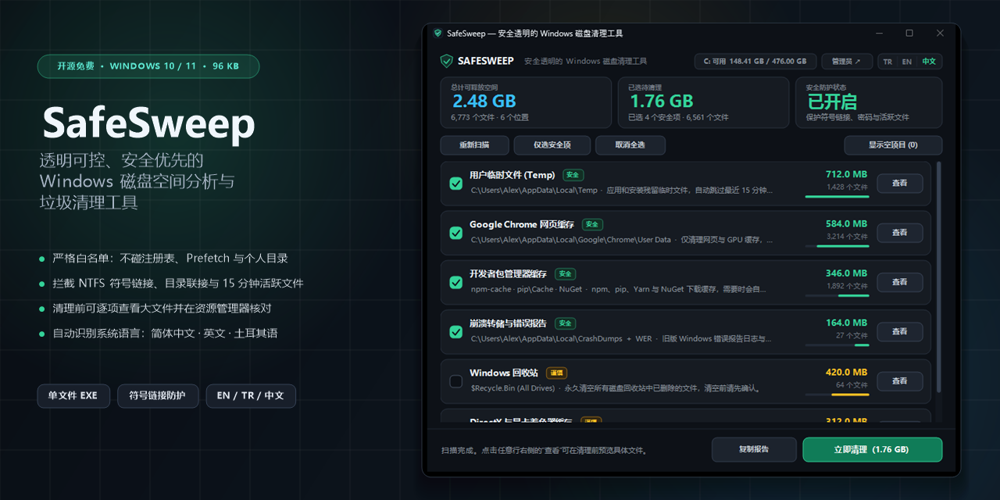
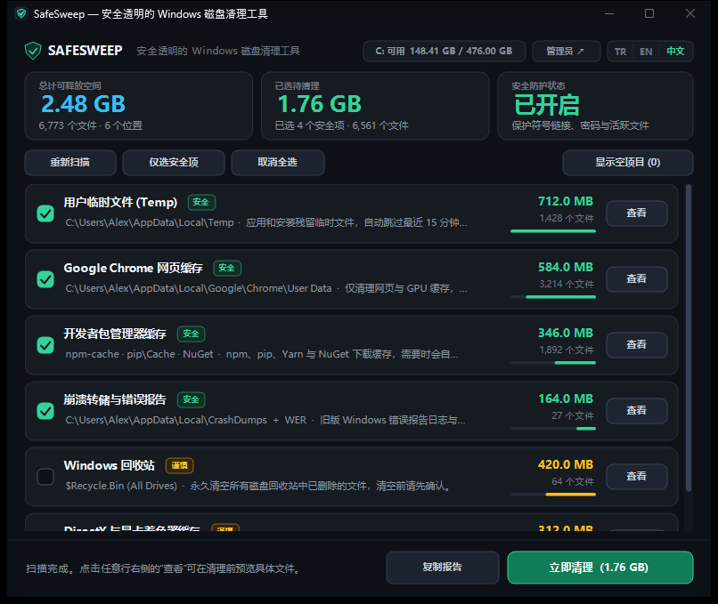
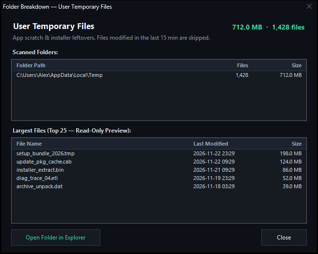
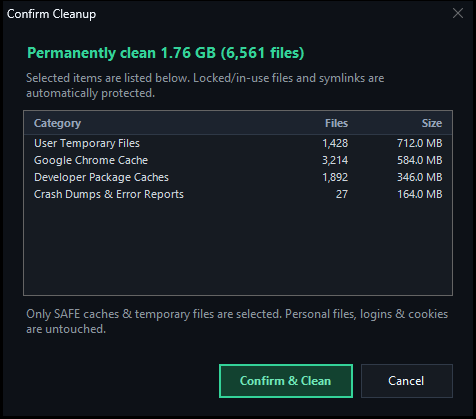

<p align="center">
  
</p>

<h1 align="center">SafeSweep — 安全透明的 Windows 磁盘清理工具</h1>

<p align="center">
  <strong>仅约 96 KB、单文件免安装、安全优先的开源 Windows 垃圾清理工具：逐项展示每个文件夹的路径、文件数与占用大小，清理前可先预览大文件并确认，杜绝误删风险。</strong>
</p>

<p align="center">
  
  
  
  
  <a href="https://linux.do"></a>
</p>

<p align="center">
  <a href="README.md"><b>English</b></a> &nbsp;·&nbsp; <b>简体中文</b> &nbsp;·&nbsp; <a href="README.md#türkçe"><b>Türkçe</b></a> &nbsp;·&nbsp; <a href="https://github.com/rodvay/SafeSweep/releases/latest"><b>下载最新版本</b></a>
</p>

---

## 为什么选择 SafeSweep？

许多传统“电脑清理/加速”软件存在广告捆绑、后台遥测、危险的注册表清理，或盲目删除会降低性能的缓存（如 `Prefetch`、`SoftwareDistribution`）甚至误清浏览器登录状态。

**SafeSweep** 坚持彻底透明与安全底线：
- **启动仅做只读扫描** — 在您明确勾选项目、点击 **立即清理** 并在弹窗二次确认前，绝不会修改或删除任何字节。
- **文件夹级完全透明** — 每一项都直接展示具体目录路径、文件总数、占用体积（MB/GB）与安全等级（**安全** / **谨慎**），点击右侧 **查看** 可浏览所有子目录和体积最大的前 25 个文件，并支持一键**在资源管理器中打开**核对。
- **系统语言自动识别** — 首次启动自动适配 Windows 系统语言：中文系统自动以**简体中文**启动，土耳其语系统自动以土耳其语启动，其余语言默认英文；右上角 **`TR | EN | 中文`** 支持随时一键切换。
- **多层文件系统安全防护** — 严格路径白名单、拦截 NTFS 符号链接/目录联接、保护 OneDrive 云端占位文件、15 分钟活跃文件保护、零注册表操作。

---

## 界面预览

<p align="center">
  <br />
  <sub><b>简体中文主界面</b> — 清晰区分“安全”与“谨慎”项目，支持查看具体路径与占比</sub>
</p>

<table>
  <tr>
    <td align="center" width="50%">
      <br />
      <sub><b>文件夹详情窗口</b> — 预览子目录、前 25 大文件并支持资源管理器打开</sub>
    </td>
    <td align="center" width="50%">
      <br />
      <sub><b>强制清理确认</b> — 删除前列出所有待清理项、文件数与风险提示</sub>
    </td>
  </tr>
</table>

---

## 安全机制与清理范围说明

### 内置底层防护（详见 `CleanupEngine.cs` 中的 `SafetyGuard`）
1. **严格白名单 + 受保护根目录硬拦截：** 强制禁止触碰磁盘根目录（`C:\`）、`Windows`、`System32`、`Program Files`、用户主目录、`桌面`、`文档`、`下载`、`图片`、`视频`、`音乐` 与 `OneDrive`（即使 `%TEMP%` 环境变量被异常修改也会自动拦截）。
2. **NTFS 符号链接 / 目录联接 / 云占位防护：** 扫描和删除前均检测 `FILE_ATTRIBUTE_REPARSE_POINT`、`OFFLINE`、`RECALL_ON_OPEN` 与 `RECALL_ON_DATA_ACCESS`，**绝不穿透符号链接或 `mklink /J` 目录联接**，避免误删跨盘真实数据。
3. **15 分钟活跃文件保护：** 在 Temp 临时目录中，自动保留最近 15 分钟内创建或修改的文件，确保正在运行的安装程序、解压任务或编译过程不被打断。
4. **保留根目录本身：** 仅清理缓存目录**内部**的一次性文件，不删除根文件夹本身，完整保留 Windows NTFS 权限结构。
5. **优雅处理占用文件：** 绝不强制结束浏览器或应用进程；检测到浏览器运行时会标记“运行中”并安全跳过被锁定的文件，清理结束后给出精确的删除/跳过统计。

### 可选清理类别一览

| 安全等级 | 清理类别 | 清理说明 | 默认勾选 |
| :---: | :--- | :--- | :---: |
| **安全** | **用户临时文件 (Temp)** | 应用与安装残留临时文件（跳过 15 分钟内活跃文件） | 已勾选 |
| **安全** | **Windows 系统临时文件** | `C:\Windows\Temp` 临时日志与缓存（可选点击“管理员 ↗”提权深度清理） | 已勾选 |
| **安全** | **崩溃转储与错误报告** | 旧版 `.dmp` 崩溃转储文件及 Windows 错误报告归档（WER） | 已勾选 |
| **安全** | **Windows 缩略图缓存** | 严格仅匹配 `thumbcache_*.db` 与 `iconcache_*.db`，资源管理器自动重建 | 已勾选 |
| **安全** | **主流浏览器网页缓存** *(Chrome / Edge / Brave / Opera / Firefox)* | 仅清理 `Cache`、`Code Cache`、`GPUCache`、`cache2` — **绝不删除 Cookie、已存密码、登录状态、历史记录、书签与扩展** | 已勾选 |
| **安全** | **Discord / Steam / Spotify 缓存** | 仅清理图片/商店网页与音频缓存，不影响游戏本体、聊天记录与歌单 | 已勾选 |
| **安全** | **开发者包管理器缓存** | `npm-cache`、`pip\Cache`、`Yarn\Cache`、`NuGet\v3-cache`（仅检测到时显示） | 已勾选 |
| **谨慎** | **Windows 回收站** | 调用系统原生 `SHQueryRecycleBin` / `SHEmptyRecycleBin` 清空各盘回收站 | **默认不勾选** |
| **谨慎** | **DirectX 与显卡着色器缓存** | `D3DSCache` 及 AMD / NVIDIA / Intel 着色器缓存（清理后游戏首次启动可能短暂重编） | **默认不勾选** |

### 刻意排除（永不触碰）
- **Windows 注册表**（高风险且几乎不释放磁盘空间）
- **`C:\Windows\Prefetch`**（系统自动管理，删除反而拖慢常用软件启动）
- **`C:\Windows\SoftwareDistribution`**（在更新服务运行时手动删除易损坏 Windows 更新）
- **下载 / 文档 / 桌面 / WinSxS** 及 **SSD 空闲空间擦写**（保护固态硬盘寿命）

---

## 下载与使用

1. 前往 **[Releases 发布页](https://github.com/rodvay/SafeSweep/releases/latest)** 下载 **`SafeSweep.exe`**（仅约 96 KB）。
2. 双击直接运行（默认普通用户权限，不强制弹出 UAC 弹窗；如需深度清理 `C:\Windows\Temp`，可点击右上角 **管理员 ↗**）。
3. 查看各文件夹占用情况，点击 **查看** 预览文件，勾选想清理的项目后点击 **立即清理** 并确认即可。

> **关于 Windows SmartScreen 提示：** 由于开源单文件未购买商业签名证书，首次运行可能弹出 SmartScreen 提示，点击 **更多信息 → 仍要运行** 即可，也可审查源码后双击 `build.bat` 自行编译。

## 快捷键

- `F5` — 重新扫描所有目录
- `L` — 切换界面语言（**TR** → **EN** → **中文**）
- **双击任意行** — 打开**文件夹详情预览窗口**

## 从源码编译

Windows 10 / 11 自带 `.NET Framework 4.x` 编译器（`csc.exe`），无需安装 Visual Studio：

```bat
git clone https://github.com/rodvay/SafeSweep.git
cd SafeSweep
build.bat
```

## 社区与友情链接

- 感谢 **[LINUX DO](https://linux.do)** 社区的开源分享氛围与各位佬友的支持与反馈！

## 开源协议

基于 **MIT License** 开源 — 详情见 [LICENSE](LICENSE)。
